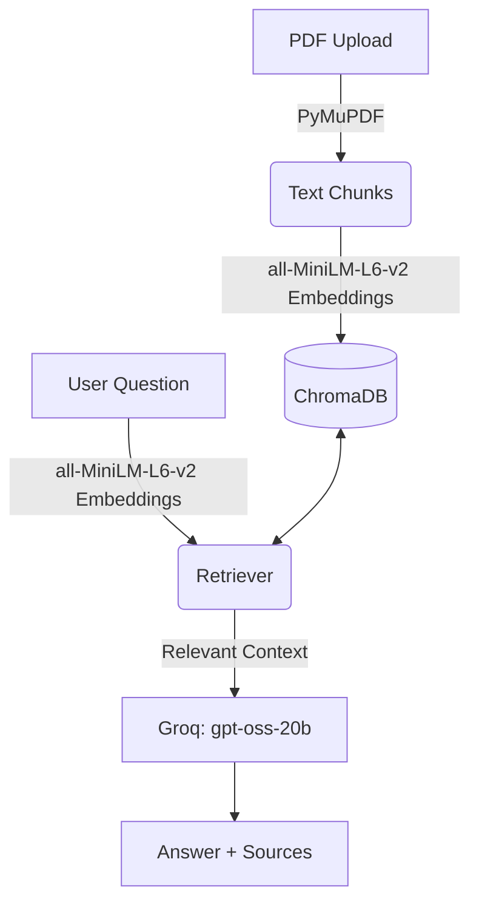

# PlaceMentor AI

A complete full-stack application that allows users to upload multiple PDFs and ask questions about their contents, with source citations for every answer.

## Architecture

This project uses a Retrieval-Augmented Generation (RAG) architecture:
- **Backend:** FastAPI, Python, LangChain, PyMuPDF, ChromaDB, Groq (GPT-OSS 20B), HuggingFace sentence-transformers
- **Frontend:** React, Vite, Tailwind CSS, Lucide React

